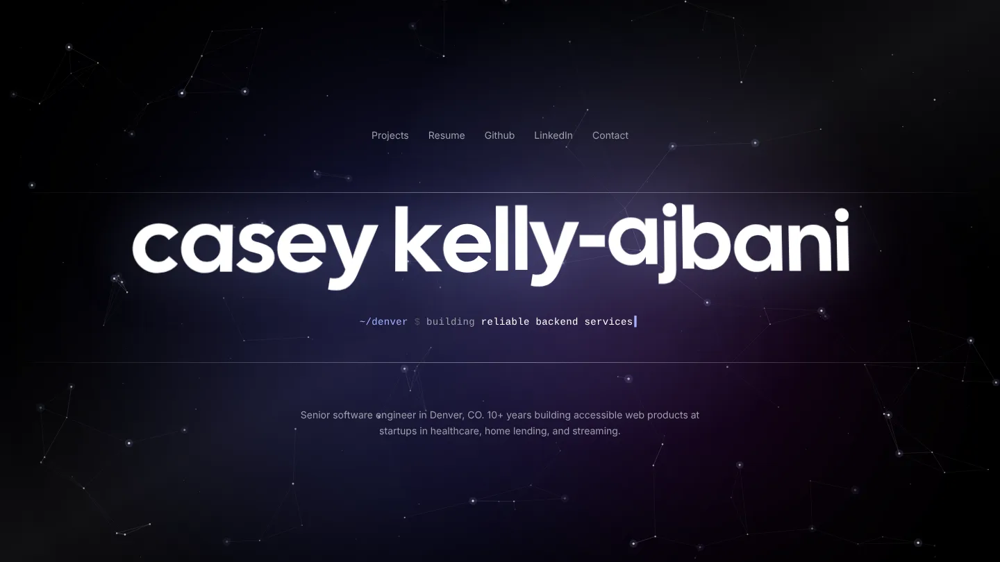
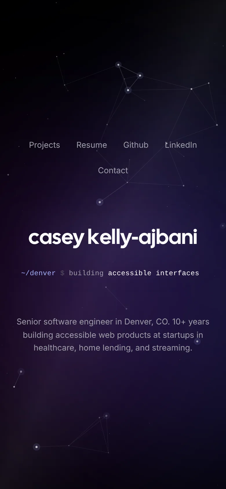
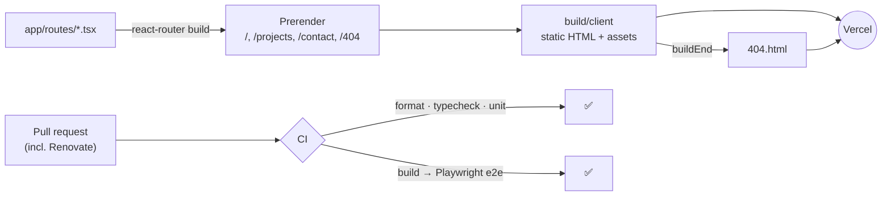
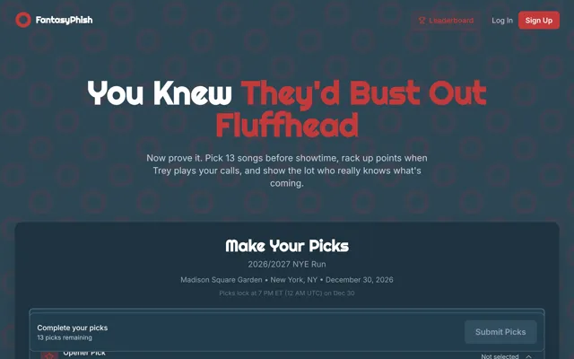
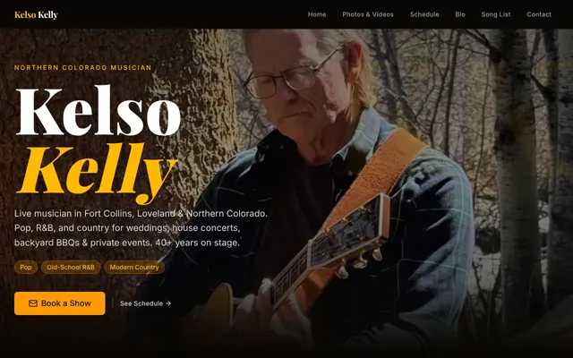

<div align="center">

<a href="https://caseyjkelly.com">
  
</a>

<p>
  <a href="https://caseyjkelly.com"><b>caseyjkelly.com</b></a> ·
  <a href="https://caseyjkelly.com/projects">Projects</a> ·
  <a href="https://caseyjkelly.com/CaseyKellyAjbaniResume.pdf">Resume</a> ·
  <a href="https://www.linkedin.com/in/caseyjkelly">LinkedIn</a> ·
  <a href="https://caseyjkelly.com/contact">Contact</a>
</p>

<p>
  <a href="https://github.com/CaseyKelly/caseyjkelly/actions/workflows/ci.yml"></a>
  
  
  
  
  
  
  
</p>

My personal website: a starfield you can play with, a name that leans toward your cursor, and a terminal that never stops typing. Built with [React Router](https://reactrouter.com/) (formerly Remix) and [Tailwind CSS](https://tailwindcss.com/), and every page is prerendered to static HTML at build time.

</div>

<br/>

<table>
  <tr>
    <td width="75%"></td>
    <td width="25%"></td>
  </tr>
</table>

## ✨ What's in it

|                           |                                                                                                                                |
| ------------------------- | ------------------------------------------------------------------------------------------------------------------------------ |
| 🌌 **Living background**  | Drifting nebula glows behind an interactive constellation that reacts to your cursor.                                          |
| 🔤 **Kinetic type**       | The name flips in letter by letter, tilts toward the pointer, and lifts the letters closest to it ([GSAP](https://gsap.com/)). |
| ⌨️ **Terminal tagline**   | `~/denver $ building …` scrambles through what I build, from design systems to cloud infrastructure.                           |
| 🧲 **Magnetic nav**       | Links follow the cursor a little before you click them.                                                                        |
| ♿ **Motion-aware**       | Every animation respects `prefers-reduced-motion`.                                                                             |
| ⚡ **No server**          | `ssr: false` and every route prerendered, so Vercel serves plain files from the edge.                                          |
| 🧪 **Tested like an app** | Vitest unit tests plus Playwright e2e on desktop and mobile Chrome, which fail on any console error or broken asset.           |

## 🗺️ How it ships



## 🚀 Running locally

```sh-session
git clone https://github.com/caseykelly/caseyjkelly.git
cd caseyjkelly
npm install
npm run dev
```

`npm run build` writes the static site to `build/client`, which Vercel serves as-is (see `vercel.json`). There is no server: every route is prerendered, and unknown paths get `404.html`.

## 🧪 Testing

CI (`.github/workflows/ci.yml`) runs on every pull request, including Renovate's:

```sh-session
npm run format:check   # Prettier
npm run typecheck      # React Router route types + tsc
npm test               # Vitest unit tests (npm run test:coverage for a coverage report)
npm run build          # static production build
npm run test:e2e       # Playwright against that build, desktop + mobile Chrome
```

Unit tests sit next to the code they test as `*.test.tsx`; components that render a `<Link>` use `renderWithRouter()` from `app/test-utils.tsx`. End-to-end specs live in `e2e/` and run against `build/client` served by [`serve`](https://github.com/vercel/serve), which handles clean URLs and `404.html` the way Vercel does. Every e2e test also fails on uncaught page errors, console errors, or assets that fail to load. Run `npx playwright install chromium` once before the first local e2e run.

## ➕ Adding a page

1. Add a route in `app/routes.ts`.
2. List its path under `prerender` in `react-router.config.ts`.
3. Add it to `public/sitemap.xml`.

## 🎸 Also by me

<table>
  <tr>
    <td width="50%" valign="top">
      <a href="https://www.fantasyphish.com"></a>
      <h3><a href="https://github.com/CaseyKelly/fantasyphish">FantasyPhish</a></h3>
      Fantasy sports for Phish fans: pick 13 songs, score live as the band plays them, climb the tour leaderboard.
    </td>
    <td width="50%" valign="top">
      <a href="https://www.kelsokellymusic.com"></a>
      <h3><a href="https://github.com/CaseyKelly/kelso-kelly-site">Kelso Kelly Music</a></h3>
      A musician's website that runs itself, with Google Calendar and Drive as the CMS.
    </td>
  </tr>
</table>

<div align="center">
<sub>Made in Denver, CO 🏔️</sub>
</div>
